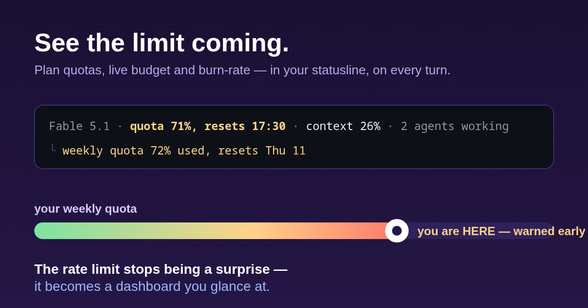
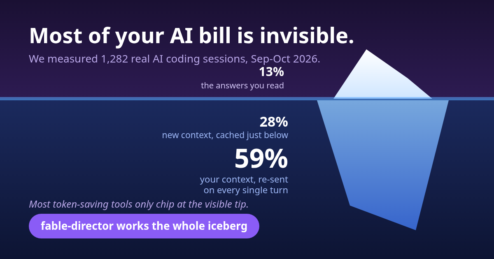
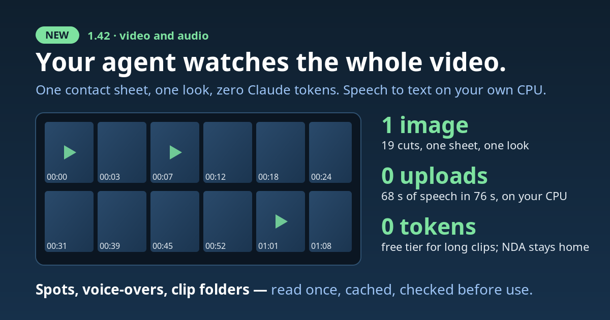

# 🎬 fable-director

  

**Keeps Claude Code from spending your top-model quota on work that doesn't
need it.** Before your agent delegates, it declares what the job should cost
and where it may write; bulk and low-risk work goes to cheap executors or
to **free external tiers by default**; a runaway job is blocked before it
drains your five-hour limit. The top model stays in charge of the final check,
and quality is a constraint, never part of the trade.



## Where your quota goes, and what this does about it



Measured on **1,282 real Claude Code sessions** (September-October 2026), only
**13%** of the spend is the answers you read: **28%** is new context being
cached and **59%** is your context re-sent on every turn. And a budget written
into the prompt does not hold: Ramp Labs ran coding agents with their budget in
the prompt, and [in over 14,000 agent messages across several model families
the budget was never
referenced](https://labs.ramp.com/research/coding-agents-ignore-spend/).

**Spend control belongs outside the model.** Here the gate, the Stop hook and
the meter are scripts the harness runs on your machine; the model is told the
figures, it is never trusted to keep them.

1. **A price before the work (`budget-open`).** Before delegating a multi-step
   job the agent declares an estimate, a write perimeter (`--paths`) and a
   check that can fail (`--verify`: a command, not prose).
2. **One canary, then the batch.** To classify 240 reviews or edit 30 files, a
   cheap pinned executor (sonnet) runs one item first; the rest starts only
   after the canary passes the check.
3. **Low-risk work off your Claude quota by default.**
   Classification, text transformations, first drafts, second opinions and
   batches of similar items take the free external route (Gemini, Codex,
   Antigravity) without asking: unused daily free quota is lost every day. The
   top model re-checks the output; client-facing final text never ships
   without its review, and `--data-class restricted` inputs never take the
   route.
4. **A circuit breaker at 3×.** A hook warns at 2× the estimate and blocks the
   turn at 3× until a post-mortem is written. Each delegation reserves its
   share of the estimate before it starts, so ten agents launched in one
   message cannot overshoot the ceiling before anyone counts them.

Closing the budget leaves a receipt you can hand on: estimate, actual tokens,
verification result and duration, in a Markdown file whose path `budget-close`
prints. A small quick task skips all of this.

## Quickstart

```bash
claude plugin install fable-director --marketplace frsorrentino/fable-director
```

One command on Claude Code 2.1.292 or newer: it adds the marketplace if it is
not there yet. On an older Claude Code, two commands:

```bash
claude plugin marketplace add frsorrentino/fable-director
claude plugin install fable-director@fsorrentino --scope user
```

Then two one-off steps:

1. Copy `fable-director/playbook-template.md` to `~/.claude/delega-playbook.md`
   — the playbook lives outside the plugin so updates never touch it.
2. Restart Claude Code once: the first session writes the statusline into `settings.json` by itself (`/fable-director:statusline --remove` turns it off).

<details>
<summary><b>Auto-update, Windows and other setups</b></summary>

- **Auto-update.** From the first session the plugin enables its own
  auto-update (announced in-session, reversible: set `"autoUpdate": false`
  under `extraKnownMarketplaces.fsorrentino` in `settings.json`, and that
  choice is respected forever).
- **Windows 11.** Works with Git for Windows and Python 3.8+ from python.org;
  details in [Windows](#windows) below.
- **Other setups.** No-CLI alternative and zip migration:
  **[ONBOARDING.md](ONBOARDING.md)**. Manual hook merge and edge cases:
  **[INSTALL.md](INSTALL.md)**.

</details>

## Measured results, and the honest price

Measured by running the **same tasks with and without the plugin**, several
times each, counting real tokens and real dollars:

| Kind of work | With the plugin | Verdict |
|---|---|---|
| **Big reading jobs** (240 long customer reviews) | Same result in 3-7 steps instead of 3-32; tokens and dollars **neutral** (−2.6% ±35%, N=6/5), **quality consistently higher** (sentiment 99% vs 94%, safety recall 98% vs 95%) | 🛡️ same cost, better result |
| **Repetitive mechanical work** (30 data files) | **~20% fewer tokens**, near-identical behavior every run | ✅ saves |
| **Real-world bug fixing** (SWE-bench Verified, official grader) | Hard issues: **same tokens, nothing lost, 2 extra resolved**, zero runaway runs. Easy issues: +47% premium | 🛡️ insurance that pays off on hard work |
| **Quick small tasks** (one question, one small fix) | **~5% to ~20% more** (shape-dependent, N small) — the fixed price of the always-on checks | ➖ the honest price |

**Who should not use it:** the always-on checks are a premium on small work —
up to **+47%** on easy self-contained bug fixes, where the discipline had
nothing to protect. If your work is mostly small and easy, this plugin is not
for you.

Where the design aims, not benchmarked as a with/without pair: **recurring
jobs** (the repeatable core of a weekly task is promoted to a script, and from
the second run that job is close to free) and **non-code batches** (the bulk
runs on free external models, off your Claude quota). These apply to specific
jobs the plugin can script or route externally, not to your Claude usage as a
whole. Measure your own work:

```bash
python3 fable-director/skills/delega-efficiente/tools/session-cost-report.py
```

**The full data is published, negative numbers included** — method, per-run
tables, variance, the run that died on a session limit, the three findings
behind the percentages, and what the harness *can't* measure:
**[benchmarks/](benchmarks/)**. Anthropic's own 2026-09-08 note on cost lands
on the same levers the plugin measures; where each one lives here:
**[docs/INTERNALS.md](docs/INTERNALS.md#what-anthropic-confirmed-2026-09-08)**.

## Built-in quota savers

### The statusline

```
Fable 5.1 high · ▸ shop · quota 21%, resets 17:30 · context 26%   caveman
```

Model, five-hour plan quota with its reset time, context — the three numbers
that are your margin, always on screen — so you see the rate limit coming
**before** it hits. Everything else shows up only when there is something to
do, in words, most urgent first (`quota 92% used, resets in 40 min · context
83% full — /fable-director:handoff, then /clear`).

A long session ends on your terms, not at the wall: when a task closes and the
context is getting heavy, the agent asks whether to write a two-page handoff
and start fresh; the next session reads it at startup instead of re-paying the
whole context (a cold reopen measured 296k tokens).

It installs itself at the first session (`/fable-director:statusline` by hand, `--remove` to turn it off); on a phone or web client
`/fable-director:status` prints the same state as text; the dense line is the
optional expert mode. Every segment: **[docs/STATUSLINE.md](docs/STATUSLINE.md)**.

### Video and audio, at zero Claude tokens

[](#video-and-audio-at-zero-claude-tokens)

A client sends a 68-second spot, a voice-over script with timings, a folder of
clips to compare. Without these tools your agent either guesses what is in them
or spends your quota reading frames one at a time. Since 1.42:

- **One image instead of dozens of screenshots.** A clip becomes a single
  contact sheet with the time printed on every frame; one frame per cut gives
  the shot list — 19 cuts, one sheet, zero tokens.
- **Speech to text on your own CPU.** 68 s of Italian speech transcribed in
  76 s, as subtitles or word-level JSON; the voice-over script is timed before
  the studio. Nothing uploaded, nothing billed.
- **A long video no longer eats your afternoon's quota.** When one sheet is not
  enough, the heavy reading goes to a free tier, off your Claude quota; you see
  the price before it runs, the result is checked before use, and material
  under NDA never leaves your machine.
- **Checked and cached.** Silent clips are called silent before anything runs;
  sheets and transcripts are cached per file, so the second look is free.

Setup once: `media-doctor.py --setup`. The `analisi-video` skill drives the rest.

### Anonymizer: placeholders, not people

[![What leaves the machine carries placeholders, not people: values stay in a local map, the model sees [PERSONA_1] [TEL_1] [CF_1] [IBAN_1], restore puts every value back byte-exact.](assets/readme/card8-anonymizer.png)](#anonymizer-placeholders-not-people)

Sending work to an external model is safer when what leaves the machine carries
placeholders. Since 1.44 the `anonymizer` package pseudonymises text: values
stay in a local map (mode 0600), the text carries stable `[EMAIL_3]`,
`[PERSONA_7]`, `[IBAN_1]` placeholders, and `restore` puts every value back,
byte-exact. Three engines, stdlib only: **rules** (Italian pack with check
digits), **columns** (CSV/TSV/JSON exports, one placeholder per cell of a known
header), **dictionary** (your clients, contacts and domains, per project). Off
by default; nothing personal in logs or reports. Phase A is the CLI (`scan`,
`redact`, `restore`, `test`, `status`): the hook into the external routes comes
next, the NER for names after that — until then a name outside your dictionary
and outside a known column is **not** seen. Demo, commands, measurements and
plan: **[docs/anonymizer-demo.md](docs/anonymizer-demo.md)**,
**[docs/plans/2026-09-09-anonymizer.md](docs/plans/2026-09-09-anonymizer.md)**.

## What is actually enforced

The distinction matters, so it's stated plainly: **hooks enforce, policy
advises.**


Enforced deterministically, on your machine: delegation without an open budget
is denied, and so is delegation without a check that can fail (`--verify`: a
command, not prose, and not `true`, `| tail` or `|| true`); spend past 3× blocks the turn until a post-mortem is written; writes
outside the declared paths are denied, and so are the destructive git commands
you deny-list; `--data-class restricted` blocks the external routes. Advisory:
the routing axes themselves, the never-delegate rules, script promotion and the
playbook — they guide the model's decisions without forcing a route. The full
table, the hook-by-hook lifecycle and the known limits:
**[docs/INTERNALS.md](docs/INTERNALS.md)**.

## External free-tier models

Have a Google or ChatGPT account? Their free tiers reset daily, and
fable-director routes low-risk work to them by default: an independent
verifier from a different model family (uncorrelated blind spots), and an
executor for classification, drafts, second opinions and non-code batches. The
top model re-checks what comes back. Providers: Gemini, Codex and Antigravity.
Ledgers stay separate, an unavailable provider is never treated as verified,
paid providers run only on explicit consent, and `--data-class restricted`
blocks the route outright. Setup and guarantees:
**[docs/EXTERNAL-MODELS.md](docs/EXTERNAL-MODELS.md)**.

## Data handling

**Reads:** what Claude Code hands its hooks (session id, model, tool names, the transcript path — from the transcript, token counts only), your `settings.json`, and the files you point the media tools or the anonymizer at.
**Writes:** `~/.claude/fable-director/` (telemetry, budgets, handoffs, media cache, anonymizer maps at mode 0600), the `statusLine` and one `autoUpdate` key in `settings.json` (announced, backed up first), and a local error log of its own scripts.
**Sends:** nothing off your machine until you set it up. The external Gemini/Codex/xAI routes, the error report to GitHub and the Whisper model download run only after you set them up or say yes; `--data-class restricted` refuses the external routes.
**Keeps:** everything until you delete it. Full policy: **[docs/privacy.md](docs/privacy.md)**.

<details>
<summary><b>For reviewers: the hooks module (mod) and the local error reports</b></summary>

### The hooks module (mod)

On Claude Code 2.1.287 and later, with Mods on, fable-director also loads a hooks module (`hooks/mods/index.ts`) next to its classic hooks. It does two things and nothing else:

- **`session.measure` writes three data files, all under `~/.claude/fable-director/`:** `quota-<account>.json` (the plan quotas, merged as the statusline does), `usage-snapshot-<account>.json` (the same reading with its time) and `quota-history-<account>.jsonl` (the last 300 quota changes). `<account>` is a short hash of the Claude config folder, so two accounts on one machine keep separate files. Only fable-director's own statusline and scripts read them. They are not build, start-up, settings or instructions files: no tool runs them and no tool takes orders from them.
- **`agent.spawn` fixes the model of fable-director's own executor, and nothing else.** When a call starts `fable-director:fd-executor` with a model other than sonnet, the module changes that call's model to sonnet. It never touches permissions: it does not allow, deny or ask on any tool call, and it leaves every other agent, and a resumed `fd-executor`, as the caller started it. The agent file already says `model: sonnet`, but a model passed in the Agent or workflow call takes precedence over the file; the pin keeps the cheap executor cheap in that case.

Where the module does not load (older Claude Code, Mods off), nothing changes: the classic hooks do the rest.

### Error reports: local, and only on your yes

The plugin notes the errors of **its own scripts** (a non-zero exit of
`fd-telemetry.py`, `external-exec.py`, `anonymizer.py` and the rest of
`scripts/`) in a **local** file,
`${XDG_STATE_HOME:-~/.local/state}/claude-observe/fable-director.jsonl` (mode
0600). Exit codes that are documented outcomes, not defects (a `cache-get`
miss, `anonymizer.py test --strict` below threshold), are skipped. Of each
command only the script name, the subcommand and the option names are kept:
every argument value becomes `<ARG>`, and the error text is scrubbed (home
path, emails, URL queries, secrets). **Nothing leaves your computer** except
one GitHub issue, anonymized, shown to you first and sent only when you say
yes: `/fable-director:observe send` shows the draft and asks: send it from
your GitHub (through `gh`, or a prefilled link you open), send it anonymously
(through the maintainer's service, see [privacy](docs/privacy.md)), or not now.
An observation marked `--security`
(a read or write outside the perimeter, a secret exposed, code run that was
not asked for, data leaving the computer) never enters a public issue:
`send --security` prepares a private report to the maintainers, see
[SECURITY.md](SECURITY.md). `/fable-director:observe` also reads the box and
adds notes by hand. Turn it
off with `{"enabled": false}` in `~/.config/claude-observe/config.json`; stop
only the offers with `{"propose": false}`. Source and record format:
[claude-observe](https://github.com/frsorrentino/claude-observe).

</details>

## Companion plugins

Works on its own. These optional companions save further tokens and degrade
gracefully when absent.

- **[`chrome-bridge`](https://github.com/frsorrentino/chrome-bridge)** — browser
  automation (same author): zero-token CLI lane, **2.3–2.8× fewer tokens** than
  the official Chrome extension. Routed by the kernel out of the box.
- **[`supervisor`](https://github.com/frsorrentino/supervisor)** (same author)
  — runs your Claude Code sessions from your phone and your watch, with a
  master session that coordinates them and a plan of tasks across sessions.
  Both plugins carry the same task contract
  (`fable-director/schemas/task-contract.v1.json`): a plan node's check becomes
  the node's `--verify`. Nothing changes when only one of the two is installed.
- **[`caveman`](https://github.com/JuliusBrussee/caveman)** — compressed output
  style, **~65% fewer output tokens** (measured).
- **[`superpowers`](https://github.com/obra/superpowers-marketplace)** — process
  discipline: a well-framed task delegates better.

Instructions you repeat in 3+ sessions (`fd-telemetry.py repeats`) become
playbook candidates, on your yes.

## Documentation

- [docs/INTERNALS.md](docs/INTERNALS.md) — routing axes, hooks, components, what it learns, what Anthropic confirmed, known limits
- [docs/STATUSLINE.md](docs/STATUSLINE.md) — every segment and alarm state
- [docs/EXTERNAL-MODELS.md](docs/EXTERNAL-MODELS.md) — Gemini, Codex and Antigravity setup
- [docs/anonymizer-demo.md](docs/anonymizer-demo.md) · [docs/plans/2026-09-09-anonymizer.md](docs/plans/2026-09-09-anonymizer.md) — anonymizer demo, architecture, phases, measurements
- [benchmarks/](benchmarks/) — full measurement data
- [INSTALL.md](INSTALL.md) · [ONBOARDING.md](ONBOARDING.md) · [CHANGELOG.md](CHANGELOG.md)

## Requirements

Claude Code ≥ 2.1.x (for the `context_window` / `rate_limits` statusline fields;
older versions degrade silently; ≥ 2.1.287 with Mods on also loads the plugin's
hooks module, which only adds), Python 3.8+ and `bash`; `ffmpeg`
and `ffprobe` only for the video and audio tools (`media-doctor.py` checks
them). Keep
`maxEffortLevel` at or above `high`, or set it per model: a lower cap silently
overrides the verifier's pinned tier
([INTERNALS](docs/INTERNALS.md#claude-fable-51-and-claude-code-21257--what-changed-what-didnt-2026-09)).

### Windows

Tested on Windows 11 with Claude Code 2.1.283: hooks, gates, perimeter, telemetry, `--verify` and the statusline work.

- **Git for Windows.** Claude Code runs hooks through its Git Bash; nothing else to set up.
- **Python 3.8+ from python.org**, reachable as `python` or `py`. `python3` on stock Windows is the Microsoft Store alias, which only prints an install hint: every hook goes through `scripts/py.sh`, which skips the alias, takes the first real interpreter and caches its path in `~/.claude/fable-director/python-path`.
- **Without Python** the kernel still loads and says the gates are off, the statusline shows one line asking for Python, and no hook reports an error.
- **To run a plugin script by hand**, use `bash <plugin>/scripts/py.sh <plugin>/scripts/<name>.py …`; the session kernel shows the full path on Windows.
- **Not tested on Windows:** the video and audio tools (`video-sheet.sh`, `transcribe.py`, `tts-timing.py`). Without `fcntl`, the subagent meter falls back to atomic renames, so two subagents that stop at the same instant can lose one count.

## License

[MIT](LICENSE) © 2026 Francesco Sorrentino
